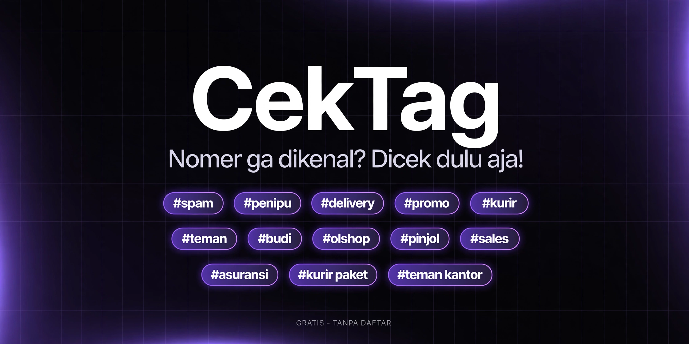

# CekTag

Look up the GetContact tags of a phone number: the names and nicknames other people saved that number under in their contacts. Made to identify unknown callers and spot spam.

Live: https://cektag.xsrazy.web.id

## About

CekTag is a paid lookup service for Indonesian phone numbers. Enter a number, and CekTag shows how other people have saved it in their contacts, pulled live from the GetContact database. Each check costs Rp 2,000, paid via QRIS, with no registration and no subscription.

## Features

- Check form with automatic formatting for 08xx numbers
- Real-time tag lookup from GetContact, with results in under 10 seconds
- Pay per check: Rp 2,000 via QRIS, no account and no subscription
- Privacy by design: results are not stored, and phone numbers and IP addresses appear in logs only as hashes that cannot be read back
- Admin panel with protected login to monitor transactions and GetContact quota usage
- FAQ and privacy pages on the site explaining how tags work and what data is kept

## How it works

1. The visitor enters the phone number they want to check
2. They pay Rp 2,000 via QRIS (one invoice per check, through the SayaBayar gateway)
3. Once the payment webhook confirms the payment, CekTag queries the GetContact API in real time
4. The list of tags for that number is displayed

## Architecture

- Frontend: Next.js 14 (App Router) with React and TypeScript; public pages are the home check form, the result view, and the privacy page
- Forms are protected with Cloudflare Turnstile
- Backend: Next.js API routes create payment invoices, receive payment webhooks, and call the GetContact API
- Storage: quota and payment sessions live in Upstash Redis, with an in-memory storage fallback
- Admin access: the admin password is stored as a bcrypt hash
- Secrets: the local `.secrets.json` credentials file is never committed; it is listed in `.gitignore`

## API

| Endpoint | Method | Description |
| --- | --- | --- |
| `/api/check` | POST | Runs the tag lookup for a phone number after its payment is confirmed |
| `/api/order` | POST | Creates a QRIS payment invoice (SayaBayar) for one check |
| `/api/order/status` | GET | Polls the payment status of an order |
| `/api/webhook/sayabayar` | POST | SayaBayar payment webhook; a valid signature unlocks the paid check |
| `/api/report` | POST | Accepts a visitor report about a number |
| `/api/stats` | GET | Public counters (checks served and similar site stats) |
| `/api/health` | GET | Health check |
| `/api/cron/daily` | GET | Daily maintenance job, protected by `CRON_SECRET` |
| `/api/admin/login`, `/api/admin/logout` | POST | Admin session login and logout |
| `/api/admin/data`, `/api/admin/action`, `/api/admin/test` | GET, POST | Admin panel data, actions, and connection tests; login required |

## Environment Variables

Names only; the values live in the Vercel project settings.

| Variable | Purpose |
| --- | --- |
| `GTC_API_URL` | GetContact API endpoint |
| `SAYABAYAR_API_KEY` | SayaBayar payment gateway key |
| `SAYABAYAR_WEBHOOK_SECRET` | Verifies SayaBayar webhook signatures |
| `UPSTASH_REDIS_REST_URL`, `UPSTASH_REDIS_REST_TOKEN` | Upstash Redis connection (KV-style variable names are also read) |
| `ADMIN_PASSWORD_HASH` | Bcrypt hash of the admin panel password |
| `TURNSTILE_SECRET_KEY`, `NEXT_PUBLIC_TURNSTILE_SITE_KEY` | Cloudflare Turnstile form protection |
| `CRON_SECRET` | Protects the daily cron endpoint |
| `GLOBAL_API_CAP` | Global cap on GetContact API usage |
| `APP_URL` | Public base URL of the app |

## Notes

- Tag accuracy depends on GetContact's crowdsourced data. Results are an indication, not a certainty

## License

MIT. See [LICENSE](LICENSE).
